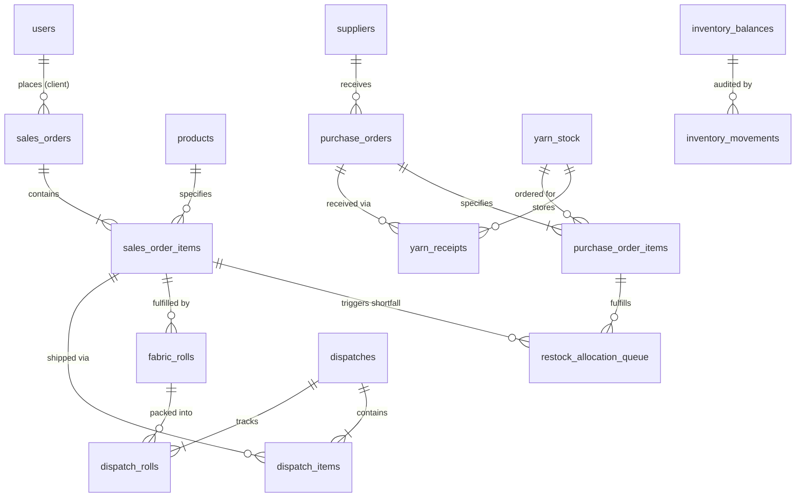
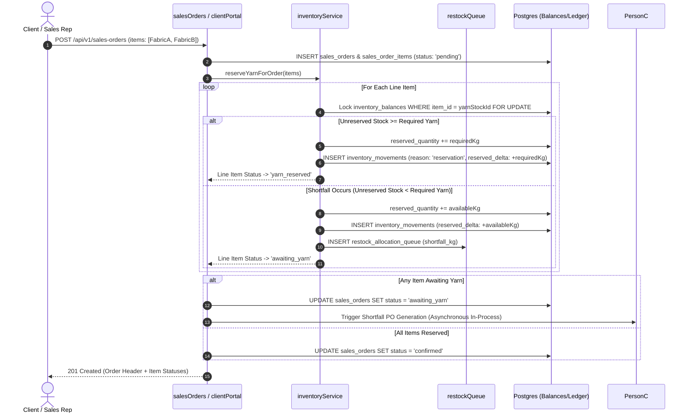
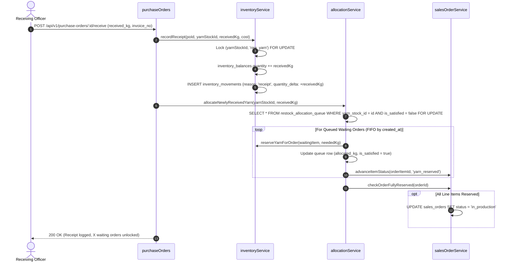
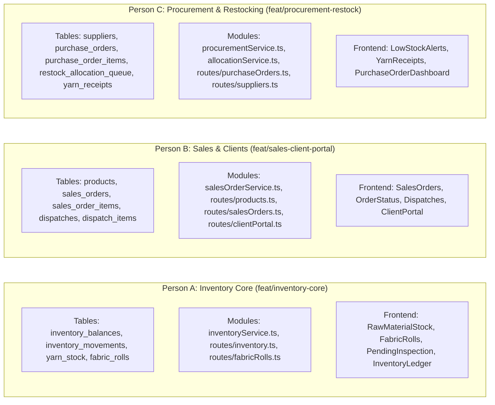

# Everest Textile Mills — Phase 2 Implementation Plan
**Document Version:** 2.0.0  
**Target Release:** Production Phase 2 (Inventory-Centered Multi-Fabric Core)  
**Authors:** Senior Systems Architect (Consolidated Plan for Persons A, B, and C)

---

## 1. Current-State Audit

A rigorous comparison between existing codebase implementations (`backend/src`, `frontend/src`), legacy planning docs (`docs/plan.md`, `docs/frontend.md`), and revised specifications (`inventory-plan.md`, `inventory-review.md`) reveals the following architectural reality:

### 1.1 What Currently Exists in Code
1. **Machine Fleet & Telemetry:** [`backend/src/routes/machines.ts`](file:///home/bow/projects/Everest-Textile-Mills/backend/src/routes/machines.ts) and tables `machines`, `machine_status_log`, `machine_output_log` are functional with Prometheus metrics.
2. **Flat Sales Orders:** [`sales_orders`](file:///home/bow/projects/Everest-Textile-Mills/backend/src/db/schema.ts#L104) is a single denormalized table coupling buyer, single `fabric_type`, `colour`, `quantity_metres`, and `status`. It cannot support orders with multiple fabrics or separate line-item fulfillment.
3. **Legacy Mutable Yarn Stock:** [`yarn_stock`](file:///home/bow/projects/Everest-Textile-Mills/backend/src/db/schema.ts#L93) mutates `quantity_kg` in place. No ledger exists in the DB yet; `inventory_movements` and `inventory_balances` are designed in `inventory-plan.md` but uncommitted to `schema.ts`.
4. **Normalized QC Enum:** `qc_result` was migrated to `('passed', 'rejected', 'pending')` in [`0001_normalize_qc_result.sql`](file:///home/bow/projects/Everest-Textile-Mills/backend/drizzle/migrations/0001_normalize_qc_result.sql). All code references to `'rework'` have been removed.
5. **Suppliers & Mappings:** `suppliers` and `yarn_type_suppliers` exist with basic CRUD, but no `purchase_orders` or shortfall tracking exist.
6. **Authentication & RBAC:** [`users`](file:///home/bow/projects/Everest-Textile-Mills/backend/src/db/schema.ts#L25) supports `admin`, `manager`, `operator`, `qc_inspector`, `viewer`. There is no `client` role or client portal.

### 1.2 Discrepancies Between Docs and Code
| Area | Documentation Claim (`docs/plan.md`, `docs/frontend.md`) | Code Reality (`schema.ts`, `routes/`) | Audit Decision (Trust Code) |
| :--- | :--- | :--- | :--- |
| **QC Enum** | Mentioned `rework` in older sections of `plan.md` | Schema has `['passed', 'rejected', 'pending']` | **Code wins.** Rework is permanently expunged. |
| **Inventory Ledger** | `inventory-plan.md` describes ledger triggers and balances | Not yet present in PostgreSQL schema | **Build target.** Implement dual-layer ledger as designed. |
| **Yarn Reservation** | `docs/plan.md` lists `reserveYarnStock` stub | `stubs.ts` has a no-op placeholder returning `true` | **Replace.** Wire to atomic ledger-backed reservations. |
| **Dispatches** | `docs/frontend.md` specifies roll validation in UI | Backend enforces `uq_dispatch_roll_single_shipment` | **Retain.** Database-level physical roll uniqueness. |

### 1.3 What Must Change vs. What Must Be Removed
- **Remove:**
  - Hardcoded client constants and simulated QC test data in [`YarnInspection.tsx`](file:///home/bow/projects/Everest-Textile-Mills/frontend/src/pages/yarn/YarnInspection.tsx).
  - Unused legacy stubs in `backend/src/services/stubs.ts`.
  - In-place mutation of `yarn_stock.quantity_kg` across route handlers.
- **Change:**
  - Redesign `sales_orders` into **Order Header** (`sales_orders`) + **Line Items** (`sales_order_items`).
  - Introduce `products` table tracking catalog SKUs sold by the mill.
  - Implement dual-layer append-only inventory core (`inventory_movements` + `inventory_balances`).
  - Add `purchase_orders`, `purchase_order_items`, and `restock_allocation_queue`.
  - Add `client` role to `userRoleEnum` and dedicated client portal routes/views.

---

## 2. Target Database Schema



### 2.1 Table Specifications

#### A. Products Table (`products`) — *Owned by Person B*
Tracks commercial fabric SKUs marketed and produced by the mill.
```sql
CREATE TABLE products (
  id                  VARCHAR(30) PRIMARY KEY, -- e.g. 'PRD-COT-TWILL-01'
  name                VARCHAR(150) NOT NULL,
  fabric_type         VARCHAR(80) NOT NULL,
  weave_type          VARCHAR(80) NOT NULL,
  gsm                 INTEGER NOT NULL CHECK (gsm > 0),
  width_inches        NUMERIC(5, 2) NOT NULL CHECK (width_inches > 0),
  colour              VARCHAR(80) NOT NULL,
  yarn_type           yarn_type NOT NULL,
  yarn_kg_per_metre   NUMERIC(6, 4) NOT NULL DEFAULT 0.2500 CHECK (yarn_kg_per_metre > 0),
  unit_price          NUMERIC(10, 2) NOT NULL CHECK (unit_price > 0),
  is_active           BOOLEAN NOT NULL DEFAULT true,
  created_at          TIMESTAMPTZ NOT NULL DEFAULT now(),
  updated_at          TIMESTAMPTZ NOT NULL DEFAULT now(),
  CONSTRAINT uq_product_spec UNIQUE (fabric_type, colour, weave_type, gsm)
);
CREATE INDEX idx_products_lookup ON products (fabric_type, colour) WHERE is_active = true;
```

#### B. Redesigned Sales Orders (`sales_orders` & `sales_order_items`) — *Owned by Person B*
Splits order header from line items to enable multi-fabric purchase orders.
```sql
CREATE TYPE order_header_status AS ENUM (
  'draft', 'pending', 'confirmed', 'awaiting_yarn', 'in_production',
  'ready_to_ship', 'partially_dispatched', 'dispatched', 'cancelled'
);

CREATE TYPE order_item_status AS ENUM (
  'pending', 'awaiting_yarn', 'yarn_reserved', 'spinning',
  'weaving', 'dyeing', 'quality_check', 'ready_to_ship', 'dispatched', 'cancelled'
);

CREATE TABLE sales_orders (
  id                  VARCHAR(20) PRIMARY KEY, -- e.g. 'ORD-1050'
  client_id           UUID NOT NULL REFERENCES users(id) ON DELETE RESTRICT,
  buyer_name          VARCHAR(200) NOT NULL,  -- denormalized for search performance
  delivery_date       DATE NOT NULL,
  created_date        DATE NOT NULL DEFAULT CURRENT_DATE,
  status              order_header_status NOT NULL DEFAULT 'pending',
  total_amount        NUMERIC(12, 2) NOT NULL DEFAULT 0 CHECK (total_amount >= 0),
  notes               TEXT,
  created_at          TIMESTAMPTZ NOT NULL DEFAULT now(),
  updated_at          TIMESTAMPTZ NOT NULL DEFAULT now()
);
CREATE INDEX idx_sales_orders_client ON sales_orders (client_id, created_date DESC);
CREATE INDEX idx_sales_orders_status ON sales_orders (status);

CREATE TABLE sales_order_items (
  id                  UUID PRIMARY KEY DEFAULT gen_random_uuid(),
  order_id            VARCHAR(20) NOT NULL REFERENCES sales_orders(id) ON DELETE CASCADE,
  item_seq            SMALLINT NOT NULL CHECK (item_seq > 0),
  product_id          VARCHAR(30) NOT NULL REFERENCES products(id) ON DELETE RESTRICT,
  quantity_metres     NUMERIC(10, 2) NOT NULL CHECK (quantity_metres > 0),
  unit_price          NUMERIC(10, 2) NOT NULL CHECK (unit_price > 0),
  total_price         NUMERIC(12, 2) NOT NULL CHECK (total_price > 0),
  required_yarn_kg    NUMERIC(10, 2) NOT NULL CHECK (required_yarn_kg > 0),
  yarn_stock_id       VARCHAR(20) REFERENCES yarn_stock(id) ON DELETE RESTRICT,
  status              order_item_status NOT NULL DEFAULT 'pending',
  completed_metres    NUMERIC(10, 2) NOT NULL DEFAULT 0 CHECK (completed_metres >= 0),
  dispatched_metres   NUMERIC(10, 2) NOT NULL DEFAULT 0 CHECK (dispatched_metres >= 0),
  assigned_machine_id VARCHAR(10) REFERENCES machines(id) ON DELETE SET NULL,
  created_at          TIMESTAMPTZ NOT NULL DEFAULT now(),
  updated_at          TIMESTAMPTZ NOT NULL DEFAULT now(),
  CONSTRAINT uq_order_item_seq UNIQUE (order_id, item_seq),
  CONSTRAINT chk_completed_le_qty CHECK (completed_metres <= quantity_metres * 1.15), -- allows 15% loom overage
  CONSTRAINT chk_dispatched_le_completed CHECK (dispatched_metres <= completed_metres)
);
CREATE INDEX idx_order_items_order ON sales_order_items (order_id);
CREATE INDEX idx_order_items_status ON sales_order_items (status);
```

#### C. Inventory Core (`inventory_balances` & `inventory_movements`) — *Owned by Person A*
```sql
CREATE TYPE inventory_item_type AS ENUM ('yarn', 'fabric', 'scrap');
CREATE TYPE inventory_state AS ENUM ('raw_yarn', 'wip', 'fabric_pending_qc', 'finished_goods', 'scrap_fabric', 'scrap_yarn');
CREATE TYPE movement_direction AS ENUM ('in', 'out');
CREATE TYPE movement_reason AS ENUM (
  'receipt', 'reservation', 'unreservation', 'consumption',
  'roll_production', 'qc_pass', 'qc_reject', 'dispatch',
  'yield_variance', 'adjustment', 'cancellation'
);

CREATE TABLE inventory_balances (
  id                UUID PRIMARY KEY DEFAULT gen_random_uuid(),
  item_type         inventory_item_type NOT NULL,
  item_id           VARCHAR(80) NOT NULL,          -- e.g. 'YS-001' or 'ORD-1038:ITEM-01'
  sku_name          VARCHAR(150) NOT NULL,
  state             inventory_state NOT NULL,
  quantity          NUMERIC(12, 2) NOT NULL DEFAULT 0 CHECK (quantity >= 0),
  reserved_quantity NUMERIC(12, 2) NOT NULL DEFAULT 0 CHECK (reserved_quantity >= 0),
  unit              VARCHAR(20) NOT NULL,          -- 'kg' or 'metres'
  location          VARCHAR(80) NOT NULL DEFAULT 'Main Floor',
  last_updated      TIMESTAMPTZ NOT NULL DEFAULT now(),
  CONSTRAINT uq_inv_balance_item_state UNIQUE (item_id, state),
  CONSTRAINT chk_avail_non_negative CHECK (quantity >= reserved_quantity)
);
CREATE INDEX idx_inv_balance_lookup ON inventory_balances (state, item_type);

CREATE TABLE inventory_movements (
  id              UUID PRIMARY KEY DEFAULT gen_random_uuid(),
  item_type       inventory_item_type NOT NULL,
  item_id         VARCHAR(80) NOT NULL,
  sku_name        VARCHAR(150) NOT NULL,
  state           inventory_state NOT NULL,
  direction       movement_direction NOT NULL,
  quantity        NUMERIC(12, 2) NOT NULL CHECK (quantity > 0),
  quantity_delta  NUMERIC(12, 2) NOT NULL,         -- +qty for 'in', -qty for 'out', 0 for reservation
  reserved_delta  NUMERIC(12, 2) NOT NULL DEFAULT 0,
  unit            VARCHAR(20) NOT NULL,
  reason          movement_reason NOT NULL,
  reference_type  VARCHAR(40) NOT NULL,            -- 'yarn_receipt', 'sales_order_item', 'fabric_roll', 'dispatch'
  reference_id    VARCHAR(80) NOT NULL,
  actor           VARCHAR(120) NOT NULL,
  unit_cost_inr   NUMERIC(10, 2),
  total_cost_inr  NUMERIC(12, 2),
  notes           TEXT,
  created_at      TIMESTAMPTZ NOT NULL DEFAULT now(),
  CONSTRAINT uq_inv_movement_idempotency UNIQUE (reference_type, reference_id, reason, state, direction)
);
CREATE INDEX idx_inv_mov_ref ON inventory_movements (reference_type, reference_id);
CREATE INDEX idx_inv_mov_item_state ON inventory_movements (item_id, state, created_at DESC);

-- Trigger: Physical Immutability
CREATE OR REPLACE FUNCTION prevent_movement_mutation() RETURNS TRIGGER AS $$
BEGIN
  RAISE EXCEPTION 'inventory_movements is append-only: updates and deletes are prohibited';
END;
$$ LANGUAGE plpgsql;

CREATE TRIGGER trg_no_update_delete_inventory_movements
BEFORE UPDATE OR DELETE ON inventory_movements
FOR EACH ROW EXECUTE FUNCTION prevent_movement_mutation();
```

#### D. Procurement & Restocking Tables — *Owned by Person C*
```sql
CREATE TYPE po_status AS ENUM ('draft', 'issued', 'partially_received', 'received', 'cancelled');

CREATE TABLE purchase_orders (
  id                      VARCHAR(25) PRIMARY KEY, -- e.g. 'PO-2026-0042'
  supplier_id             UUID NOT NULL REFERENCES suppliers(id) ON DELETE RESTRICT,
  status                  po_status NOT NULL DEFAULT 'issued',
  order_date              DATE NOT NULL DEFAULT CURRENT_DATE,
  expected_delivery_date  DATE NOT NULL,
  total_amount            NUMERIC(12, 2) NOT NULL DEFAULT 0 CHECK (total_amount >= 0),
  auto_generated          BOOLEAN NOT NULL DEFAULT false,
  notes                   TEXT,
  created_by              VARCHAR(120) NOT NULL,
  created_at              TIMESTAMPTZ NOT NULL DEFAULT now(),
  updated_at              TIMESTAMPTZ NOT NULL DEFAULT now()
);
CREATE INDEX idx_po_status_supplier ON purchase_orders (status, supplier_id);

CREATE TABLE purchase_order_items (
  id                      UUID PRIMARY KEY DEFAULT gen_random_uuid(),
  po_id                   VARCHAR(25) NOT NULL REFERENCES purchase_orders(id) ON DELETE CASCADE,
  item_seq                SMALLINT NOT NULL CHECK (item_seq > 0),
  yarn_stock_id           VARCHAR(20) NOT NULL REFERENCES yarn_stock(id) ON DELETE RESTRICT,
  ordered_kg              NUMERIC(10, 2) NOT NULL CHECK (ordered_kg > 0),
  received_kg             NUMERIC(10, 2) NOT NULL DEFAULT 0 CHECK (received_kg >= 0),
  unit_price              NUMERIC(10, 2) NOT NULL CHECK (unit_price > 0),
  total_price             NUMERIC(12, 2) NOT NULL CHECK (total_price > 0),
  created_at              TIMESTAMPTZ NOT NULL DEFAULT now(),
  updated_at              TIMESTAMPTZ NOT NULL DEFAULT now(),
  CONSTRAINT uq_po_item_seq UNIQUE (po_id, item_seq),
  CONSTRAINT chk_received_le_ordered CHECK (received_kg <= ordered_kg * 1.1) -- max 10% delivery tolerance
);
CREATE INDEX idx_po_items_stock ON purchase_order_items (yarn_stock_id);

CREATE TABLE restock_allocation_queue (
  id                      UUID PRIMARY KEY DEFAULT gen_random_uuid(),
  sales_order_item_id     UUID NOT NULL REFERENCES sales_order_items(id) ON DELETE CASCADE,
  yarn_stock_id           VARCHAR(20) NOT NULL REFERENCES yarn_stock(id) ON DELETE RESTRICT,
  shortfall_kg            NUMERIC(10, 2) NOT NULL CHECK (shortfall_kg > 0),
  allocated_kg            NUMERIC(10, 2) NOT NULL DEFAULT 0 CHECK (allocated_kg >= 0),
  linked_po_id            VARCHAR(25) REFERENCES purchase_orders(id) ON DELETE SET NULL,
  is_satisfied            BOOLEAN NOT NULL DEFAULT false,
  created_at              TIMESTAMPTZ NOT NULL DEFAULT now(),
  updated_at              TIMESTAMPTZ NOT NULL DEFAULT now(),
  CONSTRAINT uq_order_item_queue UNIQUE (sales_order_item_id)
);
CREATE INDEX idx_restock_queue_pending ON restock_allocation_queue (yarn_stock_id) WHERE is_satisfied = false;
```

#### E. Dispatches & Rolls Junction Linkage
```sql
-- Updated fabric_rolls linkage:
ALTER TABLE fabric_rolls 
  ADD COLUMN order_item_id UUID REFERENCES sales_order_items(id) ON DELETE RESTRICT,
  ADD COLUMN product_id VARCHAR(30) REFERENCES products(id) ON DELETE RESTRICT;

-- Updated dispatch_rolls:
ALTER TABLE dispatch_rolls 
  DROP CONSTRAINT IF EXISTS dispatch_roll_unique,
  ADD CONSTRAINT uq_dispatch_roll_single_shipment UNIQUE (roll_id);

CREATE TABLE dispatch_items (
  id              UUID PRIMARY KEY DEFAULT gen_random_uuid(),
  dispatch_id     VARCHAR(20) NOT NULL REFERENCES dispatches(id) ON DELETE CASCADE,
  order_item_id   UUID NOT NULL REFERENCES sales_order_items(id) ON DELETE RESTRICT,
  dispatched_metres NUMERIC(10, 2) NOT NULL CHECK (dispatched_metres > 0),
  roll_count      INTEGER NOT NULL CHECK (roll_count > 0),
  created_at      TIMESTAMPTZ NOT NULL DEFAULT now(),
  CONSTRAINT uq_dispatch_order_item UNIQUE (dispatch_id, order_item_id)
);
```

---

### 2.2 Migration & Backfill Strategy

To prevent downtime and avoid breaking seed records (`seed.ts`), the migration runs in a single zero-data-loss transaction:

```text
Step 1: Create new tables (products, sales_order_items, purchase_orders, purchase_order_items,
        inventory_balances, inventory_movements, restock_allocation_queue, dispatch_items).
Step 2: Backfill `products`: Extract distinct (fabricType, colour) combinations from existing
        `sales_orders` and `fabric_rolls`, inserting active product catalog entries.
Step 3: Backfill `sales_order_items`: For each existing `sales_orders` row, create a line item
        with seq = 1, linking to the matched `products.id`. Copy quantity_metres, unit_price,
        completed_metres, and status.
Step 4: Backfill Foreign Keys: Set `fabric_rolls.order_item_id` and `fabric_rolls.product_id`
        based on matched `sales_order_items`.
Step 5: Backfill In-Flight Inventory Balances:
        - raw_yarn: Seed from `yarn_stock` (quantity = quantityKg).
        - wip: For orders in spinning/weaving/dyeing, compute remainingKg = (quantityMetres - completedMetres) * 0.25;
          insert balance row scoped by `${order_id}:${item_id}`.
        - fabric_pending_qc: Sum metres of pending rolls grouped by order item.
        - finished_goods: Sum metres of passed, undispatched rolls grouped by order item.
        - scrap_fabric: Sum metres of rejected rolls.
Step 6: Append baseline 'receipt', 'consumption', and 'roll_production' rows to `inventory_movements`.
Step 7: Alter `sales_orders` to drop legacy columns (fabricType, colour, quantityMetres, completedMetres).
```

---

## 3. End-to-End Key Flows

### Flow 1: Order Placement & Inventory Reservation (Multi-Fabric)


**Failure Case / Rollback:**
- If any line item references an inactive product or has invalid specs, transaction aborts with HTTP 400.
- If concurrent reservations deplete stock between availability check and reservation lock, row-level locks force sequential evaluation; the second transaction automatically enters the shortfall branch cleanly.

---

### Flow 2: Shortfall to Purchase Order Creation & Reorder Trigger
1. **Trigger:** `procurementService.triggerShortfallPOs()` inspects unlinked rows in `restock_allocation_queue` or executes immediately after order confirmation.
2. **Supplier Resolution:** Queries `yarn_type_suppliers` for the supplier associated with `yarn_stock.type`. If multiple exist, selects primary active supplier.
3. **Transaction Execution:**
   - Group shortfalls by `supplier_id`.
   - Calculate order quantity: `orderKg = GREATEST(shortfallKg, reorder_level_batch_min)`.
   - Insert `purchase_orders` (`status: 'issued'`, `auto_generated: true`).
   - Insert `purchase_order_items` linked to the yarn stock.
   - Update `restock_allocation_queue.linked_po_id = po.id`.
4. **Failure Case:**
   - If no supplier is mapped to the yarn type, flag order item with `procurement_error = 'NO_SUPPLIER_MAPPED'`, log warning, and alert manager on dashboard without crashing API.

---

### Flow 3: PO Receipt to Stock Increase & Waiting-Order Allocation


---

### Flow 4: Production (Spinning, Weaving, Roll Creation)
1. **Machine Start (`spinning`):**
   - Atomically deducts `raw_yarn` (`quantity -= kg, reserved_quantity -= kg`) and credits `wip` (`quantity += kg`).
   - Appends two `inventory_movements` (`reason = 'consumption'`).
2. **Roll Production (`POST /api/v1/fabric-rolls`):**
   - Inputs: `order_item_id`, `machine_id`, `metres`.
   - Mass conversion: `consumedKg = metres * product.yarn_kg_per_metre`.
   - Locks `(order_item_wip, 'wip')` and `(order_item_fabric, 'fabric_pending_qc')` in alphabetical order.
   - Debits `wip` by `consumedKg`, credits `fabric_pending_qc` by `metres`.
   - Inserts `fabric_rolls` with `qc_result = 'pending'`.
   - Increments `sales_order_items.completed_metres += metres`.

---

### Flow 5: Quality Control Inspection (Binary Outcomes Only)
1. **Inspector Action (`PATCH /api/v1/fabric-rolls/:id/qc`):**
   - Only `passed` or `rejected` permitted.
   - Enforces roll currently has `qc_result = 'pending'`.
2. **Inventory Movements:**
   - Always debits `fabric_pending_qc.quantity -= roll.metres`.
   - If **`passed`**: Credits `finished_goods.quantity += roll.metres` (`reason = 'qc_pass'`).
   - If **`rejected`**: Credits `scrap_fabric.quantity += roll.metres` (`reason = 'qc_reject'`).
3. **Line Item Evaluation:**
   - If passed meters $\ge$ `sales_order_items.quantity_metres`, marks item as `ready_to_ship`.
   - If all items in sales order are `ready_to_ship`, marks `sales_orders.status = 'ready_to_ship'`.

---

### Flow 6: Dispatch & Shipment
1. **Shipment Creation (`POST /api/v1/dispatches`):**
   - Validates all selected rolls have `qc_result = 'passed'`.
   - Enforces unique constraint: no roll can be in `dispatch_rolls` more than once.
   - Locks `finished_goods` balance for each associated order item.
   - Debits `finished_goods.quantity -= rollMetres`.
   - Inserts `dispatches`, `dispatch_items`, and `dispatch_rolls`.
   - Updates `sales_order_items.dispatched_metres += metres`.
   - If all items fully dispatched, order transitions to `dispatched`; otherwise `partially_dispatched`.

---

### Flow 7: Order Cancellation & Compensating Reversals
1. **Cancellation (`POST /api/v1/sales-orders/:id/cancel`):**
   - Permitted only if status is `pending`, `confirmed`, or `awaiting_yarn`.
   - If yarn was reserved:
     - Locks `inventory_balances` for reserved yarn bin.
     - `reserved_quantity -= reservedKg`.
     - Appends movement: `quantity_delta = 0, reserved_delta = -reservedKg, reason = 'cancellation'`.
   - If queued in `restock_allocation_queue`: Marks queue record as cancelled.
   - If linked PO was auto-generated and in `issued` state with no other dependencies: Flags PO for review or cancellation.

---

## 4. API Surface & Authorization

### 4.1 RBAC Permission Matrix

| Endpoint Group | Admin | Manager | Operator | QC Inspector | Viewer | Client |
| :--- | :---: | :---: | :---: | :---: | :---: | :---: |
| **Inventory Core** (`/api/v1/inventory/*`) | Read/Write | Read/Adjust | Read | Read | Read | **Denied** |
| **Fabric Rolls & QC** (`/api/v1/fabric-rolls/*`) | Full | Full | Log Output | Submit QC | Read | **Denied** |
| **Internal Sales** (`/api/v1/sales-orders/*`) | Full | Full | Read Stages | Read | Read | **Denied** |
| **Client Portal** (`/api/v1/client/*`) | Full View | Full View | **Denied** | **Denied** | **Denied** | **Self Only** |
| **Procurement & POs** (`/api/v1/purchase-orders/*`) | Full | Full | Receive Stock | **Denied** | Read | **Denied** |
| **Suppliers** (`/api/v1/suppliers/*`) | Full | Full | Read | **Denied** | Read | **Denied** |

---

### 4.2 Endpoint Specifications

#### Group A: Inventory Core (Owned by Person A)
| Method | Path | Auth / Role | Query / Body Params | Response Shape (`data`) |
| :--- | :--- | :--- | :--- | :--- |
| `GET` | `/api/v1/inventory/balances` | Authenticated Staff | `?state=raw_yarn&item_type=yarn` | Array of `InventoryBalance` (qty, reserved, avail) |
| `GET` | `/api/v1/inventory/movements` | Authenticated Staff | `?page=1&limit=50&item_id=...&reason=...` | Paginated `InventoryMovement` with metadata |
| `GET` | `/api/v1/inventory/reconciliation` | Admin, Manager | None | `{ status: 'consistent'\|'drift_detected', checks: [...] }` |
| `POST` | `/api/v1/inventory/adjust` | Admin | `{ itemId, state, deltaKg, reason, notes }` | Updated balance + audit ledger entry |
| `GET` | `/api/v1/fabric-rolls` | Authenticated Staff | `?qcResult=passed&orderItemId=...` | Array of `FabricRoll` |
| `POST` | `/api/v1/fabric-rolls` | Admin, Manager, Operator | `{ orderItemId, machineId, metres }` | Created `FabricRoll` + WIP debit / QC credit |
| `PATCH` | `/api/v1/fabric-rolls/:id/qc` | Admin, QC Inspector | `{ qcResult: 'passed'\|'rejected', defects?: [] }` | Updated roll + finished/scrap movement |

#### Group B: Sales Orders & Client Portal (Owned by Person B)
| Method | Path | Auth / Role | Query / Body Params | Response Shape (`data`) |
| :--- | :--- | :--- | :--- | :--- |
| `GET` | `/api/v1/products` | All (incl. Client) | `?fabricType=&isActive=true` | Array of `Product` with specs & pricing |
| `POST` | `/api/v1/products` | Admin, Manager | `{ id, name, fabricType, weaveType, gsm, width, colour, yarnType, yarnKgPerMetre, unitPrice }` | Created `Product` |
| `GET` | `/api/v1/sales-orders` | Authenticated Staff | `?status=&clientId=&page=1&limit=25` | Array of `SalesOrderHeader` with items |
| `GET` | `/api/v1/sales-orders/:id` | Authenticated Staff | None | Detailed `SalesOrder` with item progress steppers |
| `POST` | `/api/v1/sales-orders` | Admin, Manager | `{ clientId, deliveryDate, items: [{ productId, quantityMetres }] }` | Created Order with line items & reservation |
| `POST` | `/api/v1/sales-orders/:id/cancel` | Admin, Manager | `{ reason }` | Cancelled order + released reservations |
| `POST` | `/api/v1/dispatches` | Admin, Manager | `{ orderId, truckNo, invoiceNo, rollIds: [] }` | Created dispatch + finished goods debit |
| `GET` | `/api/v1/client/orders` | Client | `?status=&page=1` | Array of orders belonging strictly to `req.user.id` |
| `POST` | `/api/v1/client/orders` | Client | `{ deliveryDate, items: [{ productId, quantityMetres }] }` | Created order belonging to authenticated client |
| `GET` | `/api/v1/client/orders/:id` | Client | None | Single client order status with tracking milestones |

#### Group C: Procurement & Restocking (Owned by Person C)
| Method | Path | Auth / Role | Query / Body Params | Response Shape (`data`) |
| :--- | :--- | :--- | :--- | :--- |
| `GET` | `/api/v1/purchase-orders` | Authenticated Staff | `?status=&supplierId=&page=1` | Array of `PurchaseOrder` with line items |
| `GET` | `/api/v1/purchase-orders/:id` | Authenticated Staff | None | Detailed `PurchaseOrder` profile |
| `POST` | `/api/v1/purchase-orders` | Admin, Manager | `{ supplierId, expectedDeliveryDate, items: [...] }` | Created manual PO |
| `POST` | `/api/v1/purchase-orders/:id/receive` | Admin, Manager, Operator | `{ invoiceNo, items: [{ poItemId, receivedKg }] }` | Inward receipt + stock credit + allocation run |
| `GET` | `/api/v1/procurement/queue` | Admin, Manager | `?isSatisfied=false` | Pending restock allocation queue items |
| `GET` | `/api/v1/yarn/stock/alerts` | Authenticated Staff | None | Calculated shortfall & reorder alerts |
| `GET` | `/api/v1/suppliers` | Authenticated Staff | `?yarnType=` | Supplier list with mapped yarn categories |

---

## 5. Work Split, Parallel Rules & Branch Strategy

### 5.1 Ownership Matrix



### 5.2 Phase 0 Shared Contract (Merged First to `main`)
- **Owner:** Person A constructs initial PR; reviewed and signed off by Persons B and C within 4 hours.
- **Contents:**
  1. Complete Drizzle schema in `backend/src/db/schema.ts` containing all new tables, enums, indexes, and relations.
  2. Database migration `0002_inventory_sales_procurement_core.sql` with zero-data-loss backfill.
  3. Shared TypeScript interfaces (`backend/src/types/contract.ts` and `frontend/src/types/index.ts`).
  4. Typed error classes in `backend/src/lib/errors.ts` (`InsufficientStockError`, `ShortfallTriggeredError`, `IdempotencyConflictError`).
  5. In-process stub interfaces in `backend/src/services/stubs.ts`:
     - `IInventoryService`
     - `IProcurementService`
     - `IAllocationService`
     - `ISalesOrderService`
- **Rule:** Once Phase 0 merges to `main`, no engineer may alter table names or column types without an explicit Phase 0.1 RFC approved by all three owners.

### 5.3 Typed Cross-Person Handoffs

```typescript
// backend/src/types/contract.ts

// Handoff 1: Person B calls Person A (Yarn Reservation)
export interface IInventoryService {
  reserveYarnForOrder(
    tx: PgTransaction,
    params: {
      orderId: string;
      orderItemId: string;
      yarnStockId: string;
      requiredKg: number;
      actor: string;
    }
  ): Promise<{
    success: boolean;
    reservedKg: number;
    shortfallKg: number;
  }>;

  // Handoff 3: Person C calls Person A (Receipt crediting inventory)
  recordReceipt(
    tx: PgTransaction,
    params: {
      receiptId: string;
      poId?: string;
      yarnStockId: string;
      receivedKg: number;
      unitCostInr?: number;
      actor: string;
      invoiceNo: string;
    }
  ): Promise<{
    movementId: string;
    newBalanceKg: number;
  }>;
}

// Handoff 2: Person B calls Person C (Shortfall Trigger)
export interface IProcurementService {
  createShortfallPO(
    tx: PgTransaction,
    params: {
      orderId: string;
      orderItemId: string;
      yarnStockId: string;
      shortfallKg: number;
      actor: string;
    }
  ): Promise<{
    poId: string;
    supplierId: string;
    orderedKg: number;
    status: 'issued';
  }>;
}

// Handoff 4: Person C calls Person B (Allocating Stock to Waiting Orders)
export interface IAllocationService {
  allocateNewlyReceivedYarn(
    tx: PgTransaction,
    params: {
      yarnStockId: string;
      receivedKg: number;
      actor: string;
    }
  ): Promise<{
    satisfiedQueueIds: string[];
    unlockedOrderItems: Array<{ orderItemId: string; orderId: string; status: 'yarn_reserved' }>;
  }>;
}
```

### 5.4 Merge Sequence, Branch Management & Conflict Mitigation
1. **Branch Names:**
   - Base Contract: `feat/phase-0-contract`
   - Person A: `feat/person-a-inventory-core`
   - Person B: `feat/person-b-sales-portal`
   - Person C: `feat/person-c-procurement-restock`
2. **Merge Sequence:**
   - **Step 1:** Merge `feat/phase-0-contract` into `main`.
   - **Step 2:** Persons A, B, and C branch off updated `main`.
   - **Step 3:** Person A merges `feat/person-a-inventory-core` into `main` (real `inventoryService` replaces stubs).
   - **Step 4:** Persons B and C rebase on `main`. Person C integrates with Person A's real `inventoryService`.
   - **Step 5:** Person C merges `feat/person-c-procurement-restock` into `main`.
   - **Step 6:** Person B rebases on `main`. Wires automatic PO trigger and client portal. Merges `feat/person-b-sales-portal`.
3. **Shared Hotspot Files & Conflict Rules:**
   - `backend/src/db/schema.ts`: **Locked after Phase 0.** No individual branch may modify `schema.ts`.
   - `backend/src/index.ts`: Each person registers their dedicated router file (`app.use('/api/v1/inventory', inventoryRouter)`). Route mounts are separated by explicit comment blocks.
   - `frontend/src/App.tsx` and `Sidebar.tsx`: Routes are strictly scoped to designated paths (`/yarn/*`, `/sales/*`, `/portal/*`).

---

## 6. Per-Person Milestones (Shippable & Testable)

### 6.1 Person A: Inventory Core Milestones
- [ ] **A.1 (Schema & Trigger):** Implement `inventory_balances`, `inventory_movements`, and append-only database trigger. Verify direct SQL updates are rejected.
- [ ] **A.2 (Service Implementation):** Build `inventoryService.ts` implementing `recordReceipt`, `reserveYarnForOrder`, `consumeYarnToWip`, `produceRoll`, `recordQcVerdict`, and `dispatchRolls`.
- [ ] **A.3 (Rolls & QC Flow):** Refactor `fabricRolls.ts` and `YarnInspection.tsx` to utilize `inventoryService`. Verify binary QC (`passed` $\rightarrow$ finished goods, `rejected` $\rightarrow$ scrap fabric).
- [ ] **A.4 (Audit & Reconciliation):** Implement `GET /api/v1/inventory/reconciliation` with 4 mathematical cross-checks. Build frontend Inventory Ledger view.

### 6.2 Person B: Sales, Products & Client Portal Milestones
- [ ] **B.1 (Products Catalog):** Implement `products` table and `/api/v1/products` CRUD with fabric specifications, pricing, and nominal yarn consumption rates.
- [ ] **B.2 (Multi-Fabric Order Engine):** Build `sales_orders` and `sales_order_items` endpoints. Implement multi-item yarn requirement calculation and status progression FSM.
- [ ] **B.3 (Client Portal API & RBAC):** Implement `client` user role, JWT payload scoping, and `/api/v1/client/orders` endpoints strictly enforcing tenant isolation.
- [ ] **B.4 (Frontend Portal & Order Views):** Build client portal UI (order placement form with fabric catalog dropdowns, order milestone tracker) and update internal Sales Orders table for multi-line items.

### 6.3 Person C: Procurement & Automated Restocking Milestones
- [ ] **C.1 (Purchase Orders Core):** Build `purchase_orders` and `purchase_order_items` tables and API. Wire supplier relationship and PDF/Challan metadata.
- [ ] **C.2 (Shortfall Trigger & Queue):** Implement `procurementService.createShortfallPO` and `restock_allocation_queue`. Auto-generate issued POs when reservations fail.
- [ ] **C.3 (PO Receiving & Inward Stock):** Implement `POST /purchase-orders/:id/receive`, updating physical stock through Person A's `inventoryService`.
- [ ] **C.4 (Waiting-Order Allocation):** Build `allocationService.ts` to process the allocation queue on PO receipt, transitioning waiting orders to `in_production`. Wire working "Raise PO" modal in `LowStockAlerts.tsx`.

---

## 7. Testing Strategy

```text
┌────────────────────────────────────────────────────────────────────────┐
│                        Testing Pyramid Strategy                         │
├───────────────────────┬────────────────────────────────────────────────┤
│ Layer                 │ Target Coverage & Validation Focus             │
├───────────────────────┼────────────────────────────────────────────────┤
│ 1. Unit & Edge        │ FSM transitions, Zod validations, math deltas  │
│ 2. Concurrency        │ Deterministic lock ordering, 10x race tests    │
│ 3. Idempotency        │ Duplicate network retries on receipts/dispatches│
│ 4. Reconciliation     │ Balance == sum(movements), roll cross-checks   │
│ 5. End-to-End         │ Order -> Shortfall -> PO -> Receipt -> Roll    │
│                       │ -> QC -> Dispatch (full lifecycle)             │
│ 6. Performance (k6)   │ 100 concurrent virtual users under peak loads  │
└───────────────────────┴────────────────────────────────────────────────┘
```

### 7.1 Integration & Concurrency Tests (`backend/src/__tests__/`)
1. **Concurrency Stress Test (`inventory_concurrency.test.ts`):**
   - Setup: Raw yarn stock has exactly 500 kg unreserved.
   - Execution: 10 concurrent requests each attempt to reserve 100 kg.
   - Assertion: Exactly 5 succeed; 5 trigger shortfall; zero over-allocation; `reserved_quantity` is exactly 500.00 kg.
2. **Idempotency Test (`inventory_idempotency.test.ts`):**
   - Execution: Transmit `POST /api/v1/yarn/receipts` twice with identical receipt reference ID and payload.
   - Assertion: Second request returns 200/201 with existing record; ledger movement count is 1; inventory is credited only once.
3. **Deadlock Prevention Test (`locking_order.test.ts`):**
   - Worker 1 transfers stock from State A $\rightarrow$ State B while Worker 2 simultaneously transfers from State B $\rightarrow$ State A.
   - Assertion: Both transactions succeed sequentially; zero `deadlock_detected` exceptions from Postgres.
4. **Tenant Isolation Test (`client_portal.test.ts`):**
   - Client X attempts `GET /api/v1/client/orders/:id` for Client Y's order.
   - Assertion: Server returns HTTP 404 (or 403 Forbidden); no data leaked.
5. **Full Lifecycle Integration Test (`e2e_mill_lifecycle.test.ts`):**
   - Client places order for 1,000m Twill requiring 250 kg Cotton. Stock has 100 kg.
   - Verify: 100 kg reserved, 150 kg shortfall queued. Auto-PO generated for 150 kg.
   - Receive PO: 150 kg logged. Verify order item auto-advances to `spinning`.
   - Produce 2 rolls (500m each): WIP debited, 2 pending rolls created.
   - QC decisions: Roll 1 `passed` (finished goods), Roll 2 `rejected` (scrap fabric).
   - Dispatch Roll 1: Verify finished goods debited, single-roll dispatch unique constraint holds.

---

## 8. Observability & Load Testing Additions

### 8.1 Prometheus Metrics

```typescript
// backend/src/metrics.ts
export const inventoryMovementCounter = new Counter({
  name: 'inventory_movements_total',
  help: 'Total count of append-only inventory movements',
  labelNames: ['state', 'direction', 'reason'] as const,
});

export const inventoryReconciliationDriftGauge = new Gauge({
  name: 'inventory_reconciliation_drift_count',
  help: 'Number of mismatched balances detected in periodic integrity audit',
});

export const procurementAutoPoCounter = new Counter({
  name: 'procurement_auto_pos_total',
  help: 'Total auto-generated purchase orders triggered by material shortfalls',
  labelNames: ['yarn_type', 'supplier_id'] as const,
});

export const clientPortalRequestsCounter = new Counter({
  name: 'client_portal_requests_total',
  help: 'Traffic volume through the external client portal',
  labelNames: ['endpoint', 'status_code'] as const,
});
```

### 8.2 k6 Load Testing Scenarios (`backend/src/__tests__/k6/`)
1. **Scenario 1: High-Frequency Shop Floor Roll Logging (`k6_rolls.js`)**
   - 50 virtual users simulating loom operators logging rolls every 5 seconds. Target: p95 latency < 45ms.
2. **Scenario 2: Concurrent Client Portal Checkout & Reservation (`k6_client_orders.js`)**
   - 100 virtual users placing multi-item orders against identical yarn varieties. Verifies database row locking under sustained pressure with zero negative balance check violations.

---

## 9. Risks & Open Questions

### 9.1 Technical Risks & Mitigations
| Risk | Severity | Mitigation Strategy |
| :--- | :---: | :--- |
| **Row lock contention on popular yarn bins** | **Medium** | Ensure database transactions are kept micro-short (no external HTTP calls or heavy CPU work inside `tx`). Lock only at the exact point of balance write. |
| **Loom yield deviations breaking WIP balances** | **Low** | Enforce Flow 7: Upon order item completion, any fractional remaining WIP is flushed to explicit `yield_variance` ledger entries so balance hits 0.00 kg cleanly. |
| **Accidental cross-branch schema mutations** | **High** | Enforce Phase 0 lock: Git pre-commit hook blocks changes to `backend/src/db/schema.ts` on individual branches without a version bump. |

### 9.2 Open Business Questions
1. **Minimum PO Order Quantities (MOQ):** When an automatic shortfall PO is triggered (e.g. for 35 kg), does the mill respect vendor MOQs (e.g., full pallets of 500 kg), or order exact shortfall?  
   *Assumption adopted in plan:* Order `GREATEST(shortfallKg, yarn_stock.reorderLevel)` to avoid micro-lot supplier surcharges.
2. **Partial Shipment Delivery Terms:** Should clients be billed per partial dispatch or on full sales order completion?  
   *Assumption adopted in plan:* Dispatches track exact meterage and invoice numbers per shipment; financial invoicing matches physical dispatches.
