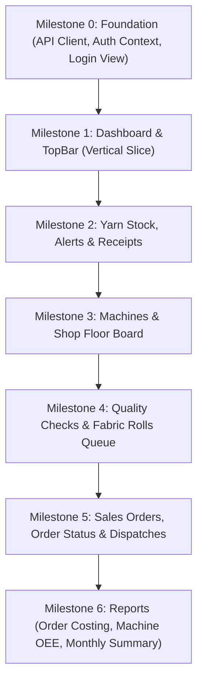

# Frontend ↔ Backend Integration Plan — Everest Textile Mills ERP

**Plan Date:** 2026-10-10  
**Target Architecture:** Vite + React (Frontend, Port 5173) ↔ Bun / Express + PostgreSQL (Backend, Port 3000)  
**Status:** Architecture & Mapping Specification (No implementation code written)  

---

## 1. Page-to-Endpoint Mapping Table

This table maps every screen in the UI to its backing backend REST endpoint(s), specifying exact data transformations.

| Page / Component | Route | Target Backend Endpoint(s) | UI Field ↔ Backend Field Mapping | Direction |
| :--- | :--- | :--- | :--- | :--- |
| **TopBar (Alerts)** | Any | `GET /api/v1/yarn/stock/alerts` | `unreadCount` ← count where `deficit > 0`<br>`items` ← `id`, `colour`, `type`, `quantityKg`, `reorderLevel`, `deficit`, `severity`, `location` | Read |
| **Dashboard** | `/dashboard` | `GET /api/v1/dashboard/kpis`<br>`GET /api/v1/dashboard/monthly-chart`<br>`GET /api/v1/dashboard/qc-summary`<br>`GET /api/v1/dashboard/machine-health`<br>`GET /api/v1/dashboard/recent-orders`<br>`GET /api/v1/dashboard/low-stock`<br>`POST /api/v1/forecast` | Direct 1:1 match with backend aggregated endpoints:<br>• `stats.*` mapped from `/kpis`, `/qc-summary`, `/machine-health`<br>• Chart data mapped from `/monthly-chart` (historical) + `/forecast` (AI)<br>• Recent orders mapped from `/recent-orders` | Read |
| **Yarn Receipts** | `/yarn/receipts` | `GET /api/v1/yarn/receipts`<br>`POST /api/v1/yarn/receipts` | `id` ↔ `id`<br>`date` ↔ `date`<br>`supplier` ↔ `supplier` (`supplierName`)<br>`yarnType` ↔ `yarnType`<br>`colour` ↔ `colour`<br>`quantityKg` ↔ `quantityKg`<br>`forOrderId` ↔ `forOrderId`<br>`invoiceNo` ↔ `invoiceNo`<br>`receivedBy` ↔ `receivedBy` | Read / Write |
| **Raw Material Stock** | `/yarn/stock` | `GET /api/v1/yarn/stock`<br>`PATCH /api/v1/yarn/stock/:id` | `id` ↔ `id`<br>`type` ↔ `type`<br>`colour` ↔ `colour`<br>`quantityKg` ↔ `quantityKg`<br>`reorderLevel` ↔ `reorderLevel`<br>`location` ↔ `location`<br>`lastUpdated` ↔ `lastUpdated` | Read / (Optional Bin Patch) |
| **Low Stock Alerts** | `/yarn/alerts` | `GET /api/v1/yarn/stock/alerts` | `critical` ← items where `severity === 'critical'`<br>`warning` ← items where `severity === 'warning'`<br>`supplier` ↔ `supplier` (string name + phone) | Read |
| **Yarn Inspection** | `/yarn/inspection` | *See Section 3 (Missing Entity)* | Record fields: `receiptId`, `batchLot`, `sampledKg`, `damagePct`, `tensileStrength`, `moisture`, `countNe`, `inspector`, `verdict` | Read / Write |
| **Machines** | `/production/machines` | `GET /api/v1/machines`<br>`POST /api/v1/machines` | `id` ↔ `id`<br>`name` ↔ `name`<br>`type` ↔ `type`<br>`status` ↔ `status`<br>`currentOrder` ↔ `currentOrder`<br>`operator` ↔ `operator`<br>`shift` ↔ `shift`<br>`progress` ↔ `progress`<br>`outputToday` ↔ `outputToday` | Read / Write |
| **Production Orders** | `/production/orders` | `GET /api/v1/production-orders`<br>`POST /api/v1/production-orders` | `id` ↔ `id`<br>`salesOrderId` ↔ `salesOrderId`<br>`buyer` ↔ `buyer`<br>`fabricType` ↔ `fabricType`<br>`colour` ↔ `colour`<br>`machineId` ↔ `machineId`<br>`machineName` ↔ `machineName`<br>`targetMetres` ↔ `targetMetres`<br>`outputMetres` ↔ `outputMetres`<br>`progress` ↔ `progress`<br>`status` ↔ `status`<br>`deliveryDate` ↔ `deliveryDate` | Read / Write |
| **Shop Floor Board** | `/production/shopfloor`| `GET /api/v1/machines` | Kanban view maps directly from `/api/v1/machines` collection | Read |
| **Quality Checks** | `/quality/checks` | `GET /api/v1/fabric-rolls`<br>`POST /api/v1/fabric-rolls` | `id` ↔ `id`<br>`orderId` ↔ `orderId`<br>`buyer` ↔ `buyer`<br>`machineId` ↔ `machineId`<br>`machineName` ↔ `machineName`<br>`metres` ↔ `metres`<br>`producedDate` ↔ `producedDate`<br>`defects` ↔ `defects`<br>`checkedBy` ↔ `checkedBy`<br>`checkedAt` ↔ `checkedAt`<br>`qcResult` ↔ `qcResult` | Read / Write |
| **Fabric Rolls** | `/quality/rolls` | `GET /api/v1/fabric-rolls`<br>`GET /api/v1/fabric-rolls/stats` | Header statistics mapped directly from `/fabric-rolls/stats`. Lineage cards map from `/fabric-rolls`. | Read |
| **Pending Inspection** | `/quality/pending` | `GET /api/v1/fabric-rolls/pending`<br>`PATCH /api/v1/fabric-rolls/:id/qc` | Reads rolls with `qcResult === 'pending'`. Action buttons submit `{ qc_result, checked_by, defects }`. | Read / Write |
| **Sales Orders** | `/sales/orders` | `GET /api/v1/sales-orders`<br>`POST /api/v1/sales-orders` | `id` ↔ `id`<br>`buyer` ↔ `buyer`<br>`fabricType` ↔ `fabricType`<br>`colour` ↔ `colour`<br>`quantityMetres` ↔ `quantityMetres`<br>`unitPrice` ↔ `unitPrice`<br>`deliveryDate` ↔ `deliveryDate`<br>`completedMetres` ↔ `completedMetres`<br>`status` ↔ `status` | Read / Write |
| **Order Status** | `/sales/status` | `GET /api/v1/sales-orders` or `GET /api/v1/sales-orders/:id` | Stepper stages mapped from backend `stages: Array<{ key, label, done, current }>` | Read |
| **Finished Goods** | `/sales/finished` | `GET /api/v1/sales-orders?status=ready_to_ship`<br>`GET /api/v1/fabric-rolls?qc_result=passed` | `readyOrders` mapped from orders where status is `ready_to_ship`, `quality_check`, or `dispatched`. Cleared roll counts mapped from passed rolls. | Read |
| **Dispatches** | `/sales/dispatches` | `GET /api/v1/dispatches`<br>`POST /api/v1/dispatches`<br>`GET /api/v1/sales-orders?status=ready_to_ship` | `id` ↔ `id`<br>`orderId` ↔ `orderId`<br>`buyer` ↔ `buyer`<br>`rollIds` ↔ `rollIds`<br>`totalMetres` ↔ `totalMetres`<br>`dispatchDate` ↔ `dispatchDate`<br>`invoiceNo` ↔ `invoiceNo`<br>`truckNo` ↔ `truckNo`<br>`status` ↔ `status` | Read / Write |
| **Order Costing** | `/reports/costing` | `GET /api/v1/reports/order-costs` | `orderId` ↔ `orderId`<br>`buyer` ↔ `buyer`<br>`yarnCost` ↔ `yarnCost`<br>`labourCost` ↔ `labourCost`<br>`machineCost` ↔ `machineCost`<br>`totalCost` ↔ `totalCost`<br>`revenue` ↔ `revenue`<br>`profit` ↔ `profit`<br>`marginPct` ↔ `marginPct` | Read |
| **Machine Performance**| `/reports/machines` | `GET /api/v1/reports/machine-performance` | `id` ↔ `id`<br>`name` ↔ `name`<br>`type` ↔ `type`<br>`status` ↔ `status`<br>`currentOrder` ↔ `currentOrder`<br>`operator` ↔ `operator`<br>`outputToday` ↔ `outputToday`<br>`target` ↔ `target`<br>`efficiencyPct` ↔ `efficiencyPct` | Read |
| **Monthly Summary** | `/reports/monthly` | `GET /api/v1/reports/monthly` | `month` ← numeric `month` (1-12) mapped to short string ("May", etc.)<br>`revenue` ↔ `revenue`<br>`cost` ↔ `cost`<br>`output` ↔ `outputMetres`<br>`wages` ↔ `wages`<br>`grossProfit` ↔ `grossProfit`<br>`marginPct` ↔ `marginPct` | Read |

---

## 2. Interface Mismatches & Decided Solutions

| Area / Item | Frontend Current | Backend Current | Solution & Location | Rationale |
| :--- | :--- | :--- | :--- | :--- |
| **API Base URL & Port** | `forecastApi.ts` defaults to port `3001` (`http://localhost:3001`). | Express backend listens on `http://localhost:3000`. | **Fix in Frontend:** Add `.env` with `VITE_API_URL=http://localhost:3000`. Centralize all requests in API client. | Smaller change; keeps backend port 3000 standard. |
| **Response Envelope** | Components expect bare data arrays/objects (from `mockData.ts`). | Backend returns standardized `{ success: true, data: T, meta?: {...} }`. | **Fix in Frontend:** API client unrolls `res.data`. Helper returns `{ data, meta }`. | Unifying in client service prevents modifying 28 backend route handlers. |
| **Authentication Header** | No token stored; no auth headers sent. | Backend strictly checks `Authorization: Bearer <token>` on all `/api/v1/*` routes (except `/forecast`). | **Fix in Frontend:** Implement lightweight `AuthContext` + `login` view; auto-attach `Authorization: Bearer <token>` in API client. | Required for backend security. |
| **Monthly Summary Month Format** | Expects month abbreviations (`"May"`, `"Jun"`) and `output`. | Returns `month: 1..12` (number), `outputMetres: number`. | **Fix in Frontend:** Add simple month mapper array `MONTHS[row.month - 1]` and alias `output: row.outputMetres`. | Frontend charting easily maps the 12 month strings. |
| **Dispatch Form Rolls** | UI form has no roll selection input; takes total length. | Backend `POST /api/v1/dispatches` accepts `rollIds?: string[]`. If omitted, auto-selects all passed rolls for that order. | **Fix in Frontend:** Form sends `{ orderId, dispatchDate, truckNo, invoiceNo }` omitting `rollIds`. Backend auto-selects all passed rolls! | Zero backend code changes needed; perfectly matches current backend design. |
| **Pagination Strategy** | `usePagination` slices arrays in browser memory. | Backend endpoints (`sales-orders`, `production-orders`, `fabric-rolls`, `dispatches`) accept `page`, `limit` and return `meta.total`. | **Fix in Frontend:** Allow `usePagination` or data fetching hooks to pass query params `?page=${p}&limit=${size}` for server-paginated endpoints. | Essential to prevent fetching 100,000s of rolls as database scales. |
| **Error Handling Shape** | No error boundaries or alert banners. | Backend returns `{ success: false, error: string, code: string }`. | **Fix in Frontend:** Interceptor surfaces `error.error` in UI toast/banner on `400/403/404/500`. | Clean user feedback without crash. |

---

## 3. Missing Endpoints or Fields Analysis

### 3.1 Entity Missing in Backend: `YarnInspectionRecord`
- **Frontend Need:** [`YarnInspection.tsx`](file:///home/bow/projects/Everest-Textile-Mills/frontend/src/pages/yarn/YarnInspection.tsx) displays incoming yarn quality tests (`damagePct`, `tensileStrength`, `moisture`, `countNe`, `verdict: accepted|rejected|pending`, `rejectionReason`).
- **Backend Current State:** The backend has `yarn_receipts` and `yarn_stock`, but does **not** have a `yarn_inspections` table or endpoint.
- **Architectural Solution:**
  - *Phase 1 (Quick Integration):* Keep `YarnInspection.tsx` in demo/mock mode with local state, OR:
  - *Phase 2 (Clean Persistence):* Add a lightweight `yarn_inspections` table in PostgreSQL (`backend/src/db/schema.ts`) and CRUD endpoints (`GET /api/v1/yarn/inspections`, `PATCH /api/v1/yarn/inspections/:id/verdict`).
  - *Decision:* Document as an Open Architectural Question for the product owner. In the interim rollout, keep local state with a simulated service or provide the schema migration.

### 3.2 Backend Endpoints Not Yet Utilized by Frontend
- `PATCH /api/v1/sales-orders/:id/status` — Backend supports advancing orders stage-by-stage (`pending` → `yarn_check` → `spinning` → ...). Currently, the UI shows a read-only timeline on `OrderStatus.tsx`. Connecting this enables advancing status directly from the UI.
- `PATCH /api/v1/machines/:id/status` — Backend allows updating machine status (`running`, `idle`, `maintenance`, `breakdown`). The UI currently has read-only cards.
- `POST /api/v1/machines/:id/output` — Backend allows logging daily output.
- `GET /api/v1/fabric-rolls/stats` — Provides aggregated counts and pass/rejection percentages. Ready to be plugged into `FabricRolls.tsx` header cards.

---

## 4. Frontend Architectural Changes

To keep the application fast, maintainable, and free of unnecessary dependencies, the following minimal additions are planned:

### 4.1 Lightweight API Client (`frontend/src/services/apiClient.ts`)
- Use native browser `fetch` (no Axios library required).
- Automatically reads `localStorage.getItem('token')` and appends `Authorization: Bearer <token>`.
- Prepends `VITE_API_URL` (defaults to `http://localhost:3000`).
- Intercepts 401 Unauthorized responses to trigger session reset / redirect.
- Normalizes errors into standard `ApiError` objects.

```typescript
// Conceptual API Client API
export const api = {
  get: <T>(url: string, params?: Record<string, any>) => Promise<{ data: T; meta?: any }>,
  post: <T>(url: string, body?: any) => Promise<T>,
  patch: <T>(url: string, body?: any) => Promise<T>,
  put: <T>(url: string, body?: any) => Promise<T>,
  delete: <T>(url: string) => Promise<T>,
};
```

### 4.2 Authentication & Session State (`frontend/src/context/AuthContext.tsx`)
- Provides `user` (`{ id, name, email, role }`), `token`, `login(email, password)`, `logout()`.
- TopBar avatar updates to show actual logged-in user name and role instead of hardcoded strings.
- Add a clean, unobtrusive `LoginModal` or `/login` route that appears when unauthenticated. Standard seeded demo accounts:
  - Admin: `admin@everest.local` / `changeme123`
  - Operator: `operator@everest.local` / `changeme123`
  - QC: `qc@everest.local` / `changeme123`

### 4.3 Data Fetching & Caching Hook (`frontend/src/hooks/useApi.ts`)
- A concise custom hook `useApi<T>(fetcherFn, dependencies)` managing:
  - `data: T | null`
  - `loading: boolean`
  - `error: string | null`
  - `refetch: () => void`
- Replaces static `mockData` imports across all 18 pages.
- Leverages existing [`PageSkeleton.tsx`](file:///home/bow/projects/Everest-Textile-Mills/frontend/src/components/ui/PageSkeleton.tsx) during loading states.

---

## 5. Backend Architectural Changes

1. **CORS Validation:** Verify that `CORS_ORIGIN` in backend `.env` includes `http://localhost:5173` (already supported by default in `backend/src/config.ts`).
2. **Yarn Inspection Route (Optional enhancement):** If required for full persistence, add `yarn_inspections` table and router.
3. **Seed Credentials Verification:** Verify demo credentials in `backend/src/db/seed.ts` are documented for UI testing.

---

## 6. Shared Types Strategy

- Since both frontend and backend are TypeScript in the same mono-repo (`frontend/` and `backend/`):
  - **Option A (Shared Package):** Monorepo npm workspace package `@everest/types`. (Adds build complexity).
  - **Option B (Recommended — Synchronized Type Definitions):** Keep [`frontend/src/types/index.ts`](file:///home/bow/projects/Everest-Textile-Mills/frontend/src/types/index.ts) updated to mirror backend Drizzle infer types and Zod schemas. This avoids mono-repo tooling overhead while guaranteeing zero bundler conflicts.

---

## 7. Real-Time & Live Polling Strategy

Certain shopfloor operations require timely updates:
- **Shop Floor Board (`/production/shopfloor`)** & **Dashboard (`/dashboard`)**:
  - Instead of adding WebSockets (which introduces reconnection logic, state sync bugs, and server overhead), use **lightweight polling**:
  - `useInterval(() => refetch(), 10000)` (every 10 seconds) when the tab is active (`document.visibilityState === 'visible'`).
  - This is trivial to implement, resilient to network drops, and easily handles hundreds of shopfloor screens without server load (cached via PostgreSQL indexes).

---

## 8. Rollout Order & Milestones

A vertical-slice rollout order ensures incremental verification without breaking existing pages:



### Detailed Milestones:
1. **Milestone 0: Foundation & Authentication**
   - Create `src/services/apiClient.ts` with error handling and Bearer token injector.
   - Create `src/context/AuthContext.tsx` with login/logout and token persistence.
   - Render login modal or screen. Verify login against `POST /api/v1/auth/login`.
2. **Milestone 1: Vertical Slice — Dashboard & TopBar**
   - Connect `Dashboard.tsx` to `/api/v1/dashboard/*` endpoints and `/forecast`.
   - Connect TopBar notification panel to `/api/v1/yarn/stock/alerts`.
   - Verify loading skeletons, chart rendering, and metric values.
3. **Milestone 2: Yarn Management**
   - Connect `RawMaterialStock.tsx` to `GET /api/v1/yarn/stock`.
   - Connect `LowStockAlerts.tsx` to `GET /api/v1/yarn/stock/alerts`.
   - Connect `YarnReceipts.tsx` to `GET /api/v1/yarn/receipts` and wire the Inward Consignment form to `POST /api/v1/yarn/receipts`.
4. **Milestone 3: Machines & Shopfloor**
   - Connect `Machines.tsx` and `ShopFloorBoard.tsx` to `GET /api/v1/machines`.
   - Connect `ProductionOrders.tsx` to `GET /api/v1/production-orders`.
5. **Milestone 4: Quality Control**
   - Connect `PendingInspection.tsx` to `GET /api/v1/fabric-rolls/pending` and wire decision buttons to `PATCH /api/v1/fabric-rolls/:id/qc`.
   - Connect `FabricRolls.tsx` and `QualityChecks.tsx` to `GET /api/v1/fabric-rolls` and `/stats`.
6. **Milestone 5: Sales & Dispatch**
   - Connect `SalesOrders.tsx` to `GET /api/v1/sales-orders` and wire order booking form to `POST /api/v1/sales-orders`.
   - Connect `OrderStatus.tsx` to `GET /api/v1/sales-orders/:id`.
   - Connect `FinishedGoods.tsx` to ready orders and passed rolls.
   - Connect `Dispatches.tsx` to `GET /api/v1/dispatches` and wire challan issuance to `POST /api/v1/dispatches`.
7. **Milestone 6: Reports & Analytics**
   - Connect `OrderCosting.tsx` to `GET /api/v1/reports/order-costs`.
   - Connect `MachinePerformance.tsx` to `GET /api/v1/reports/machine-performance`.
   - Connect `MonthlySummary.tsx` to `GET /api/v1/reports/monthly`.

---

## 9. Verification & Test Plan

For each page integrated:
1. **Network Tab Inspection:** Verify `200 OK` or `201 Created` status with `Authorization: Bearer ...` header.
2. **Contract Validation:** Check console for zero React render errors, missing property warnings, or NaN in calculations.
3. **State Transitions:**
   - Inward Yarn Receipt: Record receipt → check warehouse balance increases in Raw Material Stock.
   - QC Inspection: Pass roll in Pending Inspection → check completed metres increment on linked Sales Order.
   - Dispatch Creation: Issue dispatch for ready order → check order status updates to `dispatched` in Sales Orders.
4. **RBAC Guard Tests:** Verify `viewer` or `operator` accounts cannot trigger admin/manager mutation routes (handling 403 Forbidden gracefully).
5. **Regression Verification:** Run `bun test` in backend to ensure database integrity is never degraded.

---

## 10. Risks & Open Questions

| Risk / Question | Impact | Recommendation |
| :--- | :--- | :--- |
| **Yarn Inspection Persistence** | `YarnInspection.tsx` has no backend table or endpoint. | Clarify with product owner if yarn inspection should be persisted in a new database table or remains an offline checklist. |
| **Authentication UX** | Frontend currently has no login page or route. | Add a clean Login modal that prompts users upon first load or 401 error, defaulting to preset quick-fill buttons for demo ease. |
| **Server-Side Pagination vs Client-Side** | Client currently slices in memory; as data grows, fetching all rows will slow down UI. | Update list pages to pass `page` and `limit` to backend endpoints where supported. |
| **Database Resets** | Running `seed.ts` resets all live test data. | Keep a backup snapshot or ensure test scripts account for seed resets. |
