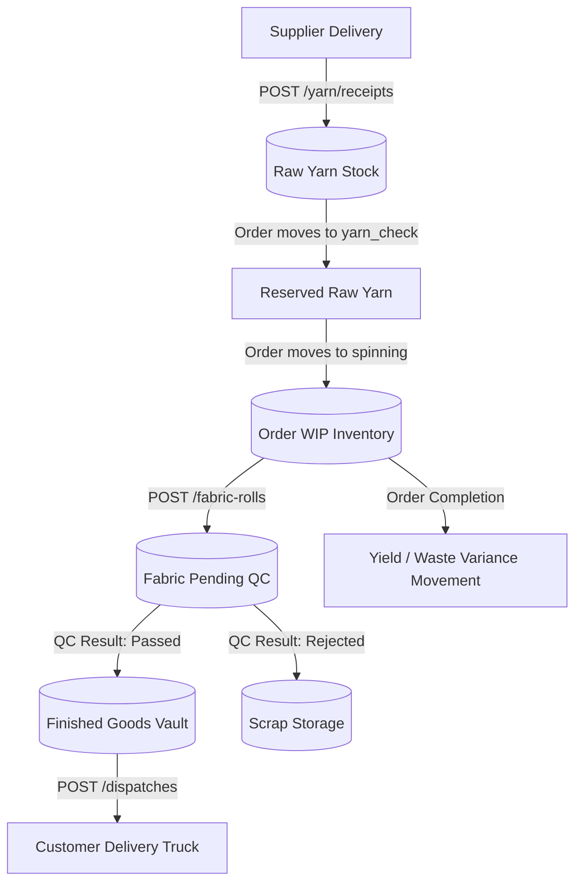

# Everest Textile Mills — Transaction-Driven Inventory Architecture Plan (`inventory-plan.md`)
*Revised post senior engineering review. Hardened against retries, deadlocks, in-flight state drift, and race conditions.*

---

## 1. Executive Summary & Objective

The Everest Textile Mills ERP backend is refactored around a **dual-layer, transaction-driven inventory core**:
1. **Append-Only Movement Ledger (`inventory_movements`)**: Immutable, event-driven ledger capturing every unit movement, direction, reason, reference (`receipt`, `sales_order`, `fabric_roll`, `dispatch`), actor, and cost. Immutability is physically enforced by a PostgreSQL database trigger.
2. **Material Balances Snapshot (`inventory_balances`)**: Real-time snapshot of on-hand and reserved quantities with database-level non-negative constraints (`CHECK quantity >= 0`, `CHECK quantity >= reserved_quantity`) and deterministic row-level locks (`SELECT ... FOR UPDATE`) to prevent concurrent race conditions and deadlocks.

Every business event that touches material runs inside an atomic PostgreSQL transaction.

---

## 2. Core Architectural Decisions

### 2.1 Dual-Layer Model Justification
- **Pure Derivation** ($\sum$ of ledger entries on every request) degrades severely over years of operational volume and cannot support native database-level check constraints against negative balances.
- **Dual-Layer Architecture** pairs the speed and constraints of a balance snapshot with the auditability and mathematical verifiability of an append-only ledger.
- Reconciliation is verified continuously:
  $$\text{Physical Balance} \equiv \sum \text{quantity\_delta}$$
  $$\text{Reserved Balance} \equiv \sum \text{reserved\_delta}$$
  $$\text{Available Balance} \equiv \text{Physical Balance} - \text{Reserved Balance}$$

### 2.2 Strict Single-Unit Rule
Every `(item_id, state)` pair has exactly **one immutable unit of measure**:
- `raw_yarn`: `kg`
- `wip`: `kg` (yarn mass allocated to active order on machines)
- `fabric_pending_qc`: `metres` (woven rolls awaiting QC verdict)
- `finished_goods`: `metres` (passed rolls in warehouse vault)
- `scrap_fabric`: `metres` (defective fabric downgraded to rag stock)
- `scrap_yarn`: `kg` (fiber waste from spinning/carding)

### 2.3 Scoped Identification (Zero Cross-Order Contamination)
To prevent Order B from silently consuming Order A's allocated materials:
- `raw_yarn`: Scoped by stock bin SKU (e.g. `YS-001`).
- `wip`: Scoped by sales order + fabric type (e.g. `ORD-1038:Cotton Denim`).
- `fabric_pending_qc`: Scoped by sales order + fabric type.
- `finished_goods`: Scoped by sales order + fabric type.
- `scrap_fabric`: Scoped by fabric type / defect category.

### 2.4 Textile Physics: Real-World QC Modeling & Conversion Variance
1. **Irreversibility of Woven Fabric**:
   - Fabric rolls that fail QC **cannot be unspun back into raw virgin yarn**.
   - `passed`: Transfers from `fabric_pending_qc` $\rightarrow$ `finished_goods`.
   - `rejected`: Transfers from `fabric_pending_qc` $\rightarrow$ `scrap_fabric` (rag storage); permanently deducted from prime inventory.
2. **Yield & Loom Variance**:
   - Theoretical conversion is $0.25\text{ kg yarn per metre of fabric}$.
   - Due to sizing gain, selvedge trimming, and loom waste, actual output deviates.
   - Instead of quietly masking discrepancy by flooring balances at zero, when an order finishes weaving, any residual WIP is closed out via an explicit `yield_variance` ledger entry (gain or waste), ensuring the WIP balance cleanly hits $0.00\text{ kg}$ with complete visibility.

---

## 3. Database Schema Specification

### 3.1 Enums & Types
```sql
CREATE TYPE inventory_item_type AS ENUM ('yarn', 'fabric', 'scrap');

CREATE TYPE inventory_state AS ENUM (
  'raw_yarn',
  'wip',
  'fabric_pending_qc',
  'finished_goods',
  'scrap_fabric',
  'scrap_yarn'
);

CREATE TYPE movement_direction AS ENUM ('in', 'out');

CREATE TYPE movement_reason AS ENUM (
  'receipt',
  'reservation',
  'unreservation',
  'consumption',
  'roll_production',
  'qc_pass',
  'qc_reject',
  'dispatch',
  'yield_variance',
  'adjustment',
  'cancellation'
);
```

### 3.2 Append-Only Movement Ledger (`inventory_movements`)
```sql
CREATE TABLE inventory_movements (
  id              UUID PRIMARY KEY DEFAULT gen_random_uuid(),
  item_type       inventory_item_type NOT NULL,
  item_id         VARCHAR(80) NOT NULL,            -- e.g. 'YS-001' or 'ORD-1038:Cotton-Denim'
  sku_name        VARCHAR(150) NOT NULL,
  state           inventory_state NOT NULL,
  direction       movement_direction NOT NULL,
  quantity        NUMERIC(12, 2) NOT NULL CHECK (quantity > 0),
  quantity_delta  NUMERIC(12, 2) NOT NULL,         -- +qty for 'in', -qty for 'out', 0 for reservation
  reserved_delta  NUMERIC(12, 2) NOT NULL DEFAULT 0, -- +qty on reserve, -qty on unreserve/consume
  unit            VARCHAR(20) NOT NULL,
  reason          movement_reason NOT NULL,
  reference_type  VARCHAR(40) NOT NULL,            -- 'yarn_receipt', 'sales_order', 'fabric_roll', 'dispatch', 'manual'
  reference_id    VARCHAR(80) NOT NULL,
  idempotency_key VARCHAR(120),
  actor           VARCHAR(120) NOT NULL,
  unit_cost_inr   NUMERIC(10, 2),                  -- Lot cost for real order costing
  total_cost_inr  NUMERIC(12, 2),
  notes           TEXT,
  created_at      TIMESTAMPTZ NOT NULL DEFAULT now(),
  CONSTRAINT uq_inv_movement_idempotency UNIQUE (reference_type, reference_id, reason, state, direction)
);

CREATE INDEX idx_inv_mov_item_state ON inventory_movements (item_id, state);
CREATE INDEX idx_inv_mov_ref ON inventory_movements (reference_type, reference_id);
CREATE INDEX idx_inv_mov_created ON inventory_movements (created_at DESC);
```

### 3.3 Immutability Enforcement (PostgreSQL Trigger)
```sql
CREATE OR REPLACE FUNCTION prevent_movement_mutation()
RETURNS TRIGGER AS $$
BEGIN
  RAISE EXCEPTION 'inventory_movements is append-only: updates and deletes are prohibited';
END;
$$ LANGUAGE plpgsql;

CREATE TRIGGER trg_no_update_delete_inventory_movements
BEFORE UPDATE OR DELETE ON inventory_movements
FOR EACH ROW EXECUTE FUNCTION prevent_movement_mutation();
```

### 3.4 Material Balances Snapshot (`inventory_balances`)
```sql
CREATE TABLE inventory_balances (
  id                UUID PRIMARY KEY DEFAULT gen_random_uuid(),
  item_type         inventory_item_type NOT NULL,
  item_id           VARCHAR(80) NOT NULL,          -- e.g. 'YS-001' or 'ORD-1038:Cotton-Denim'
  sku_name          VARCHAR(150) NOT NULL,
  state             inventory_state NOT NULL,
  quantity          NUMERIC(12, 2) NOT NULL DEFAULT 0 CHECK (quantity >= 0),
  reserved_quantity NUMERIC(12, 2) NOT NULL DEFAULT 0 CHECK (reserved_quantity >= 0),
  unit              VARCHAR(20) NOT NULL,
  location          VARCHAR(80) NOT NULL DEFAULT 'Main Floor',
  last_updated      TIMESTAMPTZ NOT NULL DEFAULT now(),
  CONSTRAINT uq_inv_balance_item_state UNIQUE (item_id, state),
  CONSTRAINT chk_avail_non_negative CHECK (quantity >= reserved_quantity)
);

CREATE INDEX idx_inv_balance_state ON inventory_balances (state);
CREATE INDEX idx_inv_balance_type ON inventory_balances (item_type);
```

### 3.5 Dispatch Integrity Constraint (`dispatch_rolls`)
```sql
-- Ensure a roll can NEVER be dispatched twice across ANY shipment in mill history
ALTER TABLE dispatch_rolls ADD CONSTRAINT uq_dispatch_roll_single_shipment UNIQUE (roll_id);
```

---

## 4. Concurrency & Deadlock Prevention Strategy

1. **Pre-Insert Pattern for Non-Existent Rows**:
   Before acquiring a row lock, execute:
   ```sql
   INSERT INTO inventory_balances (item_type, item_id, sku_name, state, quantity, reserved_quantity, unit, location)
   VALUES (:type, :id, :sku, :state, 0, 0, :unit, :loc)
   ON CONFLICT (item_id, state) DO NOTHING;
   ```
   Followed by `SELECT ... FOR UPDATE`. This guarantees the target row physically exists prior to locking.
2. **Deterministic Lock Ordering**:
   When an operation touches multiple balance rows (e.g. transfer from `raw_yarn` to `wip`, or `fabric_pending_qc` to `finished_goods`), rows are **always locked in alphabetical order** of `(item_id, state)`.
   ```sql
   SELECT * FROM inventory_balances
   WHERE (item_id = :idA AND state = :stateA) OR (item_id = :idB AND state = :stateB)
   ORDER BY item_id ASC, state ASC
   FOR UPDATE;
   ```
   This mathematically eliminates deadlocks between concurrent workers.
3. **Isolation Level**:
   PostgreSQL `READ COMMITTED` paired with explicit `SELECT ... FOR UPDATE` row locks provides complete serialized atomicity without spurious `serialization_failure` rollbacks.

---

## 5. End-to-End Event Flows



### Flow 1: Yarn Inward Delivery (`POST /api/v1/yarn/receipts`)
- **Action**: New delivery of raw yarn cones arrives at receiving dock.
- **Transaction**:
  1. Ensure bin `YS-xxx` exists; insert `yarn_receipts` record.
  2. Lock `inventory_balances` (`item_id = stockId, state = 'raw_yarn'`).
  3. `quantity += receiptKg`.
  4. Append to `inventory_movements`:
     `quantity = receiptKg, quantity_delta = +receiptKg, reserved_delta = 0, state = 'raw_yarn', reason = 'receipt', ref = receiptId`.
  5. Sync `yarn_stock.quantity_kg`.

### Flow 2: Yarn Reservation (`PATCH /api/v1/sales-orders/:id/status` -> `yarn_check`)
- **Action**: Sales order is confirmed; yarn is earmarked so other orders cannot steal it.
- **Transaction**:
  1. Calculate `requiredKg = quantityMetres * 0.25`.
  2. Lock `inventory_balances` for matching `raw_yarn` bin.
  3. Verify `(quantity - reserved_quantity) >= requiredKg`. If short, return 400: `"Insufficient unreserved stock"`.
  4. `reserved_quantity += requiredKg`.
  5. Append to `inventory_movements`:
     `quantity = requiredKg, quantity_delta = 0, reserved_delta = +requiredKg, state = 'raw_yarn', reason = 'reservation', ref = orderId`.
  6. Set order status to `yarn_check`.

### Flow 3: Production Start & Consumption (`PATCH /api/v1/sales-orders/:id/status` -> `spinning`)
- **Action**: Operator loads yarn cones onto spinning frame SP-01.
- **Transaction**:
  1. Deterministically lock `(stockId, 'raw_yarn')` and `(orderWipId, 'wip')`.
  2. In `raw_yarn`: `quantity -= requiredKg`, `reserved_quantity -= requiredKg`.
  3. In `wip`: `quantity += requiredKg`.
  4. Append two ledger movements:
     - `raw_yarn`: `quantity_delta = -requiredKg, reserved_delta = -requiredKg, reason = 'consumption', ref = orderId`.
     - `wip`: `quantity_delta = +requiredKg, reserved_delta = 0, reason = 'consumption', ref = orderId`.
  5. Sync `yarn_stock.quantity_kg`.
  6. Set order status to `spinning`.

### Flow 4: Fabric Roll Production (`POST /api/v1/fabric-rolls`)
- **Action**: Loom finishes weaving a physical roll (e.g. 500m).
- **Transaction**:
  1. Calculate equivalent yarn mass consumed: `consumedKg = metres * 0.25`.
  2. Deterministically lock `(orderWipId, 'wip')` and `(orderFabricId, 'fabric_pending_qc')`.
  3. In `wip`: `quantity -= consumedKg`. (If remaining WIP is less than consumedKg, debit available WIP and log an interim `yield_variance` movement for the difference).
  4. In `fabric_pending_qc`: `quantity += metres`.
  5. Append two ledger movements:
     - `wip`: `quantity_delta = -consumedKg, unit = 'kg', reason = 'roll_production', ref = rollId`.
     - `fabric_pending_qc`: `quantity_delta = +metres, unit = 'metres', reason = 'roll_production', ref = rollId`.
  6. Insert `fabric_rolls` record.
  7. Increment `sales_orders.completedMetres += metres`.
  8. If `completedMetres >= quantityMetres`, set order status to `quality_check`.

### Flow 5: QC Inspection Decision (`PATCH /api/v1/fabric-rolls/:id/qc`)
- **Action**: QC inspector tags roll as passed or rejected.
- **Transaction**:
  1. Verify roll currently has `qc_result = 'pending'`.
  2. Deterministically lock `(orderFabricId, 'fabric_pending_qc')` and the target balance row.
  3. In `fabric_pending_qc`: `quantity -= roll.metres`.
  4. **Destination logic**:
     - **`passed`**: `finished_goods.quantity += roll.metres`. Movement reason: `'qc_pass'`.
     - **`rejected`**: `scrap_fabric.quantity += roll.metres`. Movement reason: `'qc_reject'`.
  5. Append corresponding movements to `inventory_movements`.
  6. Update `fabric_rolls.qc_result`, `checked_by`, `checked_at`.
  7. Calculate total passed meters for the order; if $\ge$ target, advance order to `ready_to_ship`.

### Flow 6: Dispatch Consignment (`POST /api/v1/dispatches`)
- **Action**: Finished goods rolls loaded onto delivery truck.
- **Transaction**:
  1. Verify all selected rolls have `qc_result = 'passed'`.
  2. Verify none of the selected rolls exist in `dispatch_rolls` (enforced by DB unique constraint).
  3. Lock `(orderFabricId, 'finished_goods')`.
  4. Verify `finished_goods.quantity >= totalDispatchMetres`.
  5. `finished_goods.quantity -= totalDispatchMetres`.
  6. Append movement: `quantity_delta = -totalDispatchMetres, unit = 'metres', state = 'finished_goods', reason = 'dispatch', ref = dispatchId`.
  7. Insert `dispatches` and `dispatch_rolls` records.
  8. If all required order meters are dispatched, set order status to `dispatched`; otherwise maintain `ready_to_ship` (partial fulfillment).

### Flow 7: Order Closeout & WIP Variance Flush
- **Action**: Order weaving is complete and all rolls are produced.
- **Transaction**:
  1. Lock `(orderWipId, 'wip')`.
  2. If `wip.quantity > 0` (unused yarn sliver/waste):
     - Append movement: `quantity_delta = -wip.quantity, reason = 'yield_variance', notes = 'Loom process waste flush'`.
     - `wip.quantity = 0`.
  3. Ensures no phantom fractional WIP residue survives past order completion.

### Flow 8: Cancellations & Compensating Reversals
- **Rule**: Ledger entries are **NEVER deleted or updated**.
- If a dispatch is voided or an order cancelled in `yarn_check`:
  - An exact compensating record is appended (`quantity_delta = +qty` or `reserved_delta = -qty`, `reason = 'cancellation'`).
  - Corresponding balance row is restored.

---

## 6. Migration & In-Flight State Backfill

The backfill script must correctly account for all orders currently in-flight in `seed.ts` without dropping operational context:

```ts
// Backfill mapping sequence inside migration transaction:
1. Raw Yarn:
   For every yarn_stock row -> Insert inventory_balances ('raw_yarn', quantity = quantityKg).
   Log initial 'receipt' movement.

2. In-Flight Orders in Production (spinning, weaving, dyeing):
   For ORD-1042, ORD-1041, ORD-1040, ORD-1038, ORD-1045:
   remainingMetres = quantityMetres - completedMetres;
   wipKg = remainingMetres * 0.25;
   Insert inventory_balances (item_id = `${order.id}:${order.fabricType}`, state = 'wip', quantity = wipKg, unit = 'kg').
   Log initial 'consumption' movement.

3. Fabric Pending QC:
   For all fabric_rolls WHERE qc_result = 'pending':
   Group by order_id -> Insert inventory_balances ('fabric_pending_qc', quantity = sum(metres), unit = 'metres').
   Log initial 'roll_production' movement.

4. Finished Goods Vault:
   For all fabric_rolls WHERE qc_result = 'passed' AND id NOT IN (SELECT roll_id FROM dispatch_rolls):
   Group by order_id -> Insert inventory_balances ('finished_goods', quantity = sum(metres), unit = 'metres').
   Log initial 'qc_pass' movement.

5. Scrap Storage:
   For all fabric_rolls WHERE qc_result = 'rejected':
   Group by order_id -> Insert inventory_balances ('scrap_fabric', quantity = sum(metres), unit = 'metres').
   Log initial 'qc_reject' movement.
```

---

## 7. Service Architecture & API Contracts

### 7.1 Centralized Domain Service (`backend/src/services/inventoryService.ts`)
To prevent future developers from bypassing ledger rules, all inventory mutations are encapsulated:
- `recordReceipt(tx, data)`
- `reserveYarn(tx, data)`
- `consumeYarnToWip(tx, data)`
- `produceRoll(tx, data)`
- `recordQcVerdict(tx, data)`
- `dispatchRolls(tx, data)`
- `reconcileInventory(tx)`

### 7.2 API Endpoints
- `GET /api/v1/inventory/balances`
  - Query params: `?state=...&item_type=...`
  - Returns live balances with `quantity`, `reserved_quantity`, and `available_quantity`.
- `GET /api/v1/inventory/movements`
  - Query params: `?page=1&limit=50&item_id=...&state=...&reason=...`
  - Returns paginated immutable movement ledger.
- `GET /api/v1/inventory/reconciliation`
  - Performs 4 automated integrity cross-checks:
    1. Balance vs Ledger Sum ($\text{balance} \equiv \sum \text{quantity\_delta}$).
    2. Finished Goods vs Unshipped Passed Rolls.
    3. Pending QC vs Uninspected Rolls.
    4. Dispatched Total Metres vs `dispatch_rolls` sum.
  - Returns `{ status: 'consistent' | 'drift_detected', checks: [...] }`.

---

## 8. Verification & Integration Test Plan

### Test Suite (`backend/src/__tests__/inventory.test.ts`)
1. **Yarn Receipt**: Assert balance increases and movement has positive `quantity_delta`.
2. **Order Reservation**: Assert `reserved_delta = +qty` and `quantity_delta = 0`.
3. **Over-Allocation Guard**: Assert transaction aborts with 400 when reservation exceeds available stock.
4. **Spinning Start**: Assert `raw_yarn` decrements and `wip` increments in a single atomic tx.
5. **Roll Production**: Assert `wip` decrements and `fabric_pending_qc` increments.
6. **QC Pass/Reject**:
   - `passed`: transfers to `finished_goods`.
   - `rejected`: transfers to `scrap_fabric`.
7. **Double Dispatch Prevention**: Assert second dispatch with same roll is blocked by DB unique constraint.
8. **Negative Stock Engine Constraint**: Attempt a direct SQL update violating `quantity >= 0`; verify PostgreSQL rejects transaction.
9. **Concurrent Race Condition Test**: Spawn 10 simultaneous promises attempting to reserve stock from a limited 500 kg pool; verify exact allocation and zero overselling.
10. **Reconciliation Audit**: Execute `reconcileInventory()`; assert all 4 cross-checks report 0 drift.
