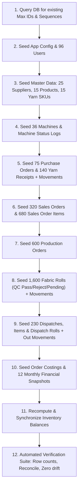

# Everest Textile Mills — Realistic Enterprise Seed Dataset Plan

## 1. Overview & Objectives

This plan designs and implements a comprehensive, realistic, and production-grade seed dataset for **Everest Textile Mills**. The dataset simulates 9–12 months of high-fidelity textile mill operations in Tamil Nadu, India, adhering to all enterprise ERP constraints:

1. **Additive Only**: Zero deletions, updates, or table truncations. Runs alongside existing seed/test rows.
2. **Deterministic & Re-runnable**: Uses a seeded Pseudo-Random Number Generator (PRNG, Mulberry32) with a fixed seed (`0xE7E57E57`). Running multiple times produces identical records and safely skips conflicts via `ON CONFLICT DO NOTHING`.
3. **Collision-Safe Sequences**: Detects current max serial IDs (`ORD-`, `DSP-`, `FR-`, `YR-`, `PO-`, `SP-`, `WV-`, `DY-`, `YS-`, `PROD-`) and continues upward with standardized formatting.
4. **4-Way Inventory Reconciliation (Zero-Drift Guarantee)**: All yarn and fabric movements are strictly mirrored in `inventory_balances` and `inventory_movements` matching physical rolls and dispatches, maintaining zero drift across all 4 automated audit checks.
5. **Zero Negative Balances**: Strictly honors DB check constraints `chk_balance_qty_non_neg`, `chk_balance_reserved_non_neg`, and `chk_balance_avail_non_neg`.
6. **Zero Orphans**: Every roll links to an order and machine; every dispatch links to QC-passed rolls; every order cost links to a sales order.

---

## 2. Target Volumes

| Entity / Table | Current Count | Seed Target To Add | Total Post-Seed | Description |
|---|---|---|---|---|
| **Users** (`users`) | 6 | ~96 | ~102 | Realistic mill workforce across 6 roles |
| **Machines** (`machines`) | 9 | 36 | 45 | 15 Spinning, 18 Weaving, 12 Dyeing |
| **Machine Status Log** (`machine_status_log`) | 483 | ~450 | ~930+ | Historical & current status snapshots |
| **Machine Output Log** (`machine_output_log`) | 18 | ~1,200 | ~1,218+ | Daily production metres log over time |
| **Suppliers** (`suppliers`) | 169 | 25 | 194 | Prominent Indian textile yarn mills |
| **Yarn Suppliers** (`yarn_type_suppliers`) | 242 | 40 | 282 | Supplier to yarn type mappings |
| **Yarn Stock SKUs** (`yarn_stock`) | 45 | 15 | 60 | Active warehouse yarn batches (some low stock) |
| **Products** (`products`) | 5 | 15 | 20 | Commercial fabric catalog (denim, twill, voile, etc.) |
| **Purchase Orders** (`purchase_orders`) | 4 | 75 | 79 | Raw yarn procurement contracts |
| **Purchase Order Items** (`purchase_order_items`) | 4 | ~120 | ~124 | PO item breakdowns |
| **Yarn Receipts** (`yarn_receipts`) | 59 | ~140 | ~199 | Physical gate delivery receipts |
| **Sales Orders** (`sales_orders`) | 71 | 320 | 391 | 300+ B2B apparel & export buyer orders |
| **Sales Order Items** (`sales_order_items`) | 259 | ~680 | ~939 | Multi-item order lines |
| **Production Orders** (`production_orders`) | 322 | ~600 | ~922 | Shopfloor batch routing orders |
| **Fabric Rolls** (`fabric_rolls`) | 84 | ~1,600 | ~1,684 | Individual inspected fabric rolls |
| **Dispatch Consignments** (`dispatches`) | 54 | ~230 | ~284 | Lorry gate passes with e-way bill / invoices |
| **Dispatch Items** (`dispatch_items`) | 22 | ~480 | ~502 | Line items delivered per dispatch |
| **Dispatch Rolls** (`dispatch_rolls`) | 49 | ~1,350 | ~1,399 | Junction mapping delivered rolls to dispatches |
| **Order Costing** (`order_costs`) | 6 | 320 | 326 | Yarn, labor, machine & margin analytics |
| **Monthly Snapshots** (`monthly_snapshots`) | 7 | 5 | 12 | Past 12 rolling financial months |
| **Inventory Balances** (`inventory_balances`) | 150 | ~420 | ~570 | Raw yarn, WIP, pending QC, FG, and scrap vaults |
| **Inventory Movements** (`inventory_movements`) | 215 | ~3,200 | ~3,415 | Immutable double-entry movement ledger |

---

## 3. ID & Serial Formatting

To prevent collisions with existing IDs, the generator queries current records and bases sequence starts above the current maxima:

| Entity | Pattern | Sequence Start | Example Formats |
|---|---|---|---|
| **Users** | UUID v4 | Random seeded | `3fa85f64-5717-4562-b3fc-2c963f66afa6` |
| **Machines** | `<TYPE>-<NN>` | Next sequential | `SP-04`..`SP-15`, `WV-04`..`WV-20`, `DY-04`..`DY-15` |
| **Yarn Stock** | `YS-<NNN>` | `YS-046` | `YS-046`, `YS-047`, ... |
| **Products** | `PROD-<NNN>` | `PROD-006` | `PROD-006`, `PROD-007`, ... |
| **Sales Orders** | `ORD-<NNNN>` | `ORD-3001` | `ORD-3001` .. `ORD-3320` |
| **Purchase Orders** | `PO-<YYYY>-<NNNN>`| `PO-2025-0101` | `PO-2025-0101` .. `PO-2026-0175` |
| **Yarn Receipts** | `YR-<YYYY>-<NNNN>`| `YR-2025-0301` | `YR-2025-0301` .. `YR-2026-0440` |
| **Fabric Rolls** | `FR-<NNNNN>` | `FR-20001` | `FR-20001` .. `FR-21600` |
| **Dispatches** | `DSP-<NNNN>` | `DSP-2001` | `DSP-2001` .. `DSP-2230` |
| **Invoices** | `INV-<YY>-<NNNN>` | `INV-25-0501` | `INV-25-0501` .. `INV-26-0820` |
| **Ledger Movements** | UUID v4 | Deterministic ID | Idempotency key: `SEED:MOV:<BATCH>:<SEQ>` |

---

## 4. State & Status Distributions

Textile mill data reflects natural manufacturing flow rather than uniform random noise:

### 4.1 Sales Order States (320 New Orders)
- **Dispatched / Delivered (`dispatched`)**: ~72% (230 orders) — Historical completed orders spanning the last 9 months.
- **Ready for Shipping (`ready_to_ship`)**: ~8% (26 orders) — Finished goods resting in vault waiting for lorry arrival.
- **Quality Check Inspection (`quality_check`)**: ~5% (16 orders) — Freshly dyed rolls awaiting grading.
- **Dyeing & Finishing (`dyeing`)**: ~4% (13 orders) — Greige fabric currently in jet dyeing vessels.
- **Weaving Looming (`weaving`)**: ~4% (13 orders) — Active on air jet and rapier looms.
- **Yarn Spinning (`spinning`)**: ~3% (10 orders) — Ring frame spinning in progress.
- **Awaiting Yarn Arrival (`awaiting_yarn`)**: ~2% (7 orders) — Allocated to pending PO receipts.
- **Confirmed / Pending (`confirmed`, `pending`)**: ~2% (5 orders) — Newly booked commercial contracts.

### 4.2 Quality Control Inspection on Rolls
- **Passed**: ~89% (~1,424 rolls) — High grade commercial cloth.
- **Rejected (Scrap)**: ~8% (~128 rolls) — Flagged with realistic defects (slub, warp breakage, oil stain, dye shade variation).
- **Pending Inspection**: ~3% (~48 rolls) — Fresh rolls produced today/yesterday.

### 4.3 Machine Statuses (45 Total Machines)
- **Running**: ~70% (31 machines) — Actively processing orders.
- **Idle**: ~18% (8 machines) — Ready for next beam change or maintenance shift.
- **Maintenance**: ~8% (4 machines) — Scheduled preventive overhaul.
- **Breakdown**: ~4% (2 machines) — Awaiting spare parts.

### 4.4 Stock Levels
- ~15% of yarn stock lines set below `reorderLevel` so Low Stock Alerts and procurement queues contain rich data.

---

## 5. Inventory Ledger & 4-Way Reconciliation Design

To pass `inventoryService.reconcileInventory()` with **zero drift**, each generated entity adheres strictly to double-entry ledger mechanics:

1. **Raw Yarn Receipts**:
   - `yarn_receipts` created with `quantityKg`.
   - `inventory_movements`: state `raw_yarn`, direction `in`, reason `receipt`, `quantityDelta = +qty`.
   - `inventory_balances`: `raw_yarn` quantity = sum of net receipts minus consumptions.
2. **Yarn Consumption in Spinning**:
   - `inventory_movements`: state `raw_yarn`, direction `out`, reason `consumption`, `quantityDelta = -qty`.
3. **Roll Production & QC Flow**:
   - **Pending Inspection**: Rolls produced but not yet checked have `inventory_movements` state `fabric_pending_qc`, direction `in`, reason `roll_production`. Matching balance in `fabric_pending_qc` equals `sum(metres)` of pending rolls.
   - **QC Pass**: Passed rolls transition to `finished_goods`. `inventory_movements` state `finished_goods`, direction `in`, reason `qc_pass`.
   - **QC Reject**: Rejected rolls transition to `scrap_fabric`. `inventory_movements` state `scrap_fabric`, direction `in`, reason `qc_reject`. Matching balance in `scrap_fabric`.
4. **Dispatch Consignment**:
   - Dispatched rolls are recorded in `dispatch_rolls`.
   - `inventory_movements`: state `finished_goods`, direction `out`, reason `dispatch`, `quantityDelta = -metres`.
   - `inventory_balances`: `finished_goods` balance for that order becomes `unshipped metres = 0` (or remaining unshipped passed rolls).
   - `dispatchVsRolls` invariant: Total dispatched movement metres equals `sum(metres)` of rolls in `dispatch_rolls`.

---

## 6. Execution Order

The seed script will execute sequentially in transactional batches:

---

## 7. Verification Suite

At the conclusion of seeding, the script automatically executes:
1. **Row Count Audit**: Prints existing vs added count for all tables.
2. **State Distribution Audit**: Verifies percentage breakdowns of orders, rolls, and machines.
3. **Automated 4-Way Inventory Reconciliation**: Runs `inventoryService.reconcileInventory()` and asserts `driftCount === 0`.
4. **Constraint & Negative Balance Check**: Validates `quantity >= 0`, `reservedQuantity >= 0`, `quantity >= reservedQuantity`.
5. **Orphan Integrity Check**: Confirms zero orphaned rolls, zero orphaned dispatches, and zero broken foreign keys.
